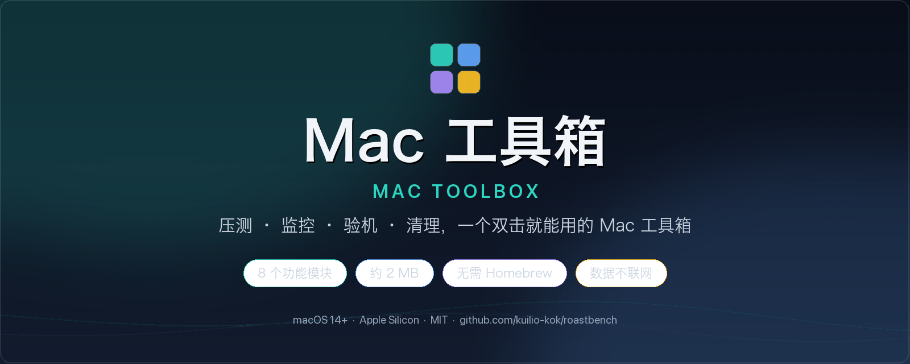
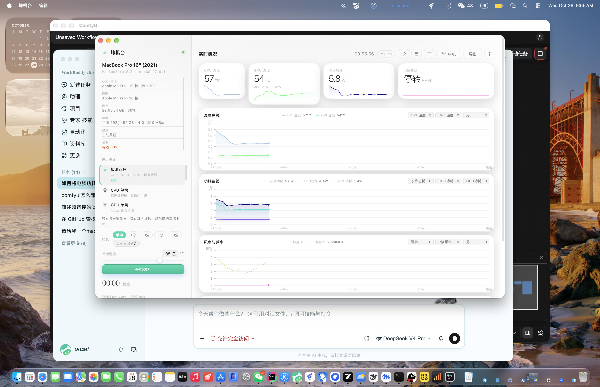

---
AIGC:
    Label: "1"
    ContentProducer: 001191440300708461136T1XGW3
    ProduceID: a1c20255bf947eb639efbd79df56ea7c_f27d656ee1a411f1a768525400cd780f
    ReservedCode1: iCvTN+qpYg9lAKrmpDTKm3Y8pQDIU+f17B/2jvRQJztZZusUzyES5DWTXn8O29b3YLWat2Blx2tzwod7UpHQ/rJNiVN+qONC+AHxwPZHnKySpa8fF+QooUFs4Oqce04aFlrtLqGlIP1v78yRBBTER3tPFsNN7cBmRfJfx6bPnIyQsXknRm4lT4pPiVE=
    ContentPropagator: 001191440300708461136T1XGW3
    PropagateID: a1c20255bf947eb639efbd79df56ea7c_f27d656ee1a411f1a768525400cd780f
    ReservedCode2: iCvTN+qpYg9lAKrmpDTKm3Y8pQDIU+f17B/2jvRQJztZZusUzyES5DWTXn8O29b3YLWat2Blx2tzwod7UpHQ/rJNiVN+qONC+AHxwPZHnKySpa8fF+QooUFs4Oqce04aFlrtLqGlIP1v78yRBBTER3tPFsNN7cBmRfJfx6bPnIyQsXknRm4lT4pPiVE=
---

<div align="center">



[](https://github.com/kuilio-kok/roastbench/releases/latest)
[](https://github.com/kuilio-kok/roastbench/releases)
[](https://github.com/kuilio-kok/roastbench/stargazers)
[](LICENSE)
[](#-系统要求与已知限制)
[](#-模块清单)

**压测、监控、验机、清理 —— 一个双击就能用的 Mac 工具箱。**
不装 Homebrew，不敲一行命令，打开就能用。

[📥 下载最新版](https://github.com/kuilio-kok/roastbench/releases/latest) · [🧭 模块清单](#-模块清单) · [🛡 安全边界](#-安全边界) · [🛠 从源码构建](#-构建与运行) · [❓ FAQ](#-faq)

</div>

---

## 🧭 定位与命名

**Mac 工具箱**是一个原生 macOS 应用：把「烤机压测」「实时监控」「二手验机」「垃圾清理」这四类平时要开终端、装 Homebrew、翻系统信息才能做的事，收进同一个窗口。

它由「烤机台 RoastBench」演进而来。

| | 烤机台 RoastBench（v2.7 – v2.9） | Mac 工具箱（v3.0 起） |
|---|---|---|
| 定位 | 单一功能的烤机 / 压力测试工具 | 通用 Mac 工具集合，压测只是其中一个分区 |
| 界面 | 单页长卷 + 卡片 | 侧栏分区导航，一次只看一件事 |
| 扩展方式 | 改页面、改框架 | 往模块注册表加一条，框架零改动 |
| 名称 | 烤机台 | **Mac 工具箱** |

改名的原因很直接：当验机、清理、诊断这些和「烤机」无关的能力接进来之后，再叫「烤机台」就已经名不副实。仓库名 `roastbench` 与 Bundle ID `cn.wangchuanhe.roastbench` 保持不变，所以老用户升级后偏好设置与历史成绩单不会丢。

> 「烤机」是硬件圈的叫法：让机器长时间满载运行，测散热、功耗与稳定性，像把机器放进烤箱里烤一遍。这个分区至今仍是工具箱里最硬核的一块。

## ✨ 它能做什么

- **10 种压力模式** — 双烤 / CPU / GPU / 内存 / 磁盘单烤，另有温度探底、阶梯升载、恒温、凉拌、电池降频
- **实时曲线** — 温度、功耗、风扇、频率按采样间隔平滑滚动，并有 60 余项传感器的完整读数
- **成绩单** — 跑完给 S / A / B / C 评级，一键导出，直接发朋友圈晒机
- **整机验机** — 8 组、60 余项信息只读采集，自动做原装性核对，可导出文本或 JSON
- **Apple 诊断引导** — 按机型给出内置硬件诊断的分步说明，确认后可由 App 关机进入诊断
- **内存清理** — 轻度 / 自选 / 全部三档，不申请管理员权限，不碰系统进程
- **磁盘清理** — 9 类垃圾只读扫描，勾选后移入废纸篓，随时可恢复
- **深度可定制** — 主题、强调色、图表配色、壁纸（含无极取色）、字号字重、界面密度、圆角、玻璃透明度、采样间隔、线程分配、登录项、中英文界面

<a id="-模块清单"></a>

## 🧩 模块清单

侧栏按分组陈列 11 个模块，每项都带实时状态徽标（就绪 / 运行中 / 在线 / 已扫描 / 发现异常…）。

| 分组 | 模块 | 一句话说明 |
|---|---|---|
| 工具 | ♨ 性能压测 | 10 种压力模式加载 CPU / GPU，记录温度、功耗与风扇曲线，结束后出成绩单 |
| 工具 | ◎ 实时监控 | 按采样间隔滚动绘制曲线，并提供全部传感器读数 |
| 检测 | ✓ 整机验机 | 只读采集 60 余项整机信息，可导出文本或 JSON |
| 检测 | ⚙ Apple 诊断 | 按机型给出苹果内置硬件诊断的分步引导 |
| 系统 | ⌥ 偏好设置 | 主题、强调色、图表配色、壁纸、采样间隔、线程分配与登录项 |
| 系统 | ⓘ 关于本机 | 机型与系统概要、部件与服务历史入口、监控卡片布局重置 |
| 清理 | ◑ 内存清理 | 三档回收内存，全程不申请管理员权限 |
| 清理 | ⌫ 磁盘清理 | 扫描缓存、日志、废纸篓、开发产物与大文件，勾选后移入废纸篓 |
| 维护 | ⌨ 键盘清洁 | 锁住键盘，放心擦拭键帽与缝隙，Esc 或点击退出 |
| 维护 | ◉ 屏幕清洁 | 纯色背景看清灰尘与污渍，擦完点击或按任意键退出 |
| 维护 | ☾ 合盖不休眠 | 合上盖子也不休眠，适合移动中跑长任务，用完记得关 |

### ♨ 性能压测

十种模式，按机器形态自选：

| 模式 | 说明 |
|---|---|
| 🔥 极限双烤 | CPU + GPU + 内存 + 磁盘全压，模拟最恶劣工况 |
| 🧠 CPU 单烤 | 只压处理器，看散热上限 |
| 🎮 GPU 单烤 | Metal 算力拉满 |
| 🧠 内存单烤 | 只打带宽，几乎不升温 |
| 💽 磁盘单烤 | 反复读写，看 SSD 表现 |
| 🌡 温度探底 | 烤 45 秒歇 15 秒，逼近温度墙 |
| 📈 阶梯升载 | 每 20 秒加一档，找功耗拐点 |
| ♨ 恒温模式 | 自动调节负载，稳住目标温度 |
| ❄ 凉拌模式 | 只开一半核心，无风扇机型用 |
| 🔋 电池降频 | 不插电能撑到多少瓦 |

配套能力：自动识别机型 / 芯片 / P-E 核数 / 内存 / 有无风扇 / 是否插电并推荐模式；默认 **108 °C 温度保险丝**（可关）；拔电即弹提示、功耗墙状态即时更新；跑完出 S / A / B / C 成绩单并留存历史；本轮采样可导出 CSV；窗口支持**置顶**与**紧凑模式**，收起后落在菜单栏也能看温度、控制烤机。

### ◎ 实时监控

按采样间隔滚动的温度、功耗、风扇、频率曲线，以及全部传感器读数的列表视图。监控卡片布局可自定义，随时「重置布局」回到默认。

### ✓ 整机验机

只读采集，分 8 组呈现，读不到的项目如实标注「—」，不做猜测：

| 分组 | 内容 |
|---|---|
| 整机身份 | 机型、序列号、芯片、CPU 核心、GPU、统一内存（含颗粒厂商）、系统固件 |
| 存储 | SSD 型号与容量、SMART 状态 |
| 电池 | 循环次数、健康度、是否原厂 |
| 显示屏 | 面板 ID、True Tone |
| 摄像头与无线 | 标识、芯片、MAC |
| 安全状态 | SIP、激活锁、指纹 |
| 系统 | 版本、安装时间、首次开机时间 |
| 原装性核对 | 软件层能做的「不拆机判断」 |

「原装性核对」会自己做交叉校验并给出 通过 / 留意 / 异常 三级结论，例如机型与芯片是否匹配、电池循环数与健康度是否自洽（循环极少却健康度偏低，可能是循环计数被重置）、SSD 是否 Apple 原厂、激活锁是否仍启用。顶部徽标同步显示「已通过 / 需留意 / 发现异常」。结果可**导出文本**与**导出 JSON**；读不到的部件（键盘上盖、风扇、I/O 板等）会给出「部件与服务历史」入口，直接打开系统信息对应页面核对官方换件记录。

### ⚙ Apple 诊断

按当前机型给出苹果内置硬件诊断（Diagnostics）的分步引导：怎么进入、按住哪个键、看到什么算正常、诊断结果代码怎么记。确认后可由 App 关机进入诊断；诊断完回到系统，再回验机页导出一份报告，把结果代码一并留档。

### ◑ 内存清理

顶部是内存概况：物理内存、已用 / 可用、App 内存、联动内存、Swap，以及按系统内存压力算出的「正常 / 偏高 / 紧张」。

| 档位 | 行为 |
|---|---|
| 轻度模式 | 不会关闭任何程序，只回收本 App 可归还的内存与系统缓存 |
| 自选模式 | 只关闭你勾选的程序，默认一个都不勾选，执行前二次确认 |
| 全部模式 | 关闭列表内全部常规用户 App，执行前展示完整名单二次确认 |

清理对象限定为「有 Bundle ID、Dock 里能看到、非 `/System` 路径、非黑名单」的常规用户 App。退出一律先 `terminate()` 优雅退出，等 5 秒仍未退出才 `forceTerminate()`，并在结果里单独标注哪些是被强制关闭的。系统级 `purge` 需要管理员权限，**直接跳过、绝不弹密码框**。

### ⌫ 磁盘清理

9 类垃圾，全部只读扫描、先看后删：

| 类别 | 位置 |
|---|---|
| 用户缓存 | `~/Library/Caches` |
| 应用日志 | `~/Library/Logs` |
| 崩溃报告 | `~/Library/Logs/DiagnosticReports` |
| 废纸篓 | `~/.Trash` |
| Xcode 派生数据 | `~/Library/Developer/Xcode/DerivedData` |
| 模拟器缓存 | `~/Library/Developer/CoreSimulator/Caches` |
| 通用临时文件 | 家目录下的 `.tmp` / `.crdownload` 等 |
| 旧 iOS 备份 | `~/Library/Application Support/MobileSync/Backup` |
| 下载与桌面大文件 | `~/Downloads`、`~/Desktop` 中大于 100 MB 的文件 |

每类标注风险等级（安全 / 留意 / 需确认）与占用体积，勾选后一键移入废纸篓。

### ⌥ 偏好设置 / ⓘ 关于本机

偏好设置覆盖外观与性能两组：主题（跟随系统 / 浅色 / 深色）、强调色、图表配色、壁纸（默认、极光、落日、夜航、素灰、无极取色、我的图片）、字号与字重（300–700 连续可调）、界面密度、圆角、玻璃透明度、采样间隔、线程分配、默认模式、中英文界面、登录项，以及一键恢复默认。

关于本机汇总机型与系统概要、版本信息，提供部件与服务历史入口，并可重置监控卡片布局。

## 📸 界面一览



> 上图为早期版本运行实拍：实时概况与温度 / 功耗 / 风扇频率曲线。v3.1 起界面已改为侧栏分区式布局，最新界面请以 Releases 中的截图为准。

<a id="-模块化架构"></a>

## 🏗 模块化可扩展架构

整个左侧导航、页面挂载、状态徽标，全部由一个注册表驱动 —— `src/ui/app.js` 里的 `TOOLBOX_MODULES`：

```js
const TOOLBOX_MODULES = [
  {
    id: "diskclean", name: "磁盘清理", icon: "⌫", group: "清理", order: 80,
    desc: "只读扫描缓存、日志、废纸篓、开发产物与大文件，勾选后移入废纸篓，可恢复。",
    badge: () => ({ text: "已扫描", tone: "ok" }),   // 状态徽标，可为 null
  },
  // ...
];
```

字段含义：`id` 决定页面模板 `tpl-<id>` 与挂载点，`group` 决定归到哪个导航分组，`order` 决定组内与分组顺序，`badge` 是实时状态徽标（可读运行时变量，返回 `{ text, tone }`）。

新增一个功能模块，只动两处、框架零改：

1. 往 `TOOLBOX_MODULES` 追加一条记录（`id / name / icon / group / order / desc / badge`）
2. 在 `src/ui/index.html` 里补一份 `<template id="tpl-xxx">`，沿用统一的卡片与标题区结构
3. 需要在 `MODULE_HOOKS[id]` 里挂进入时的首次渲染 / resize 逻辑
4. 若模块需要原生能力（扫描、清理、进程列表），在 `src/main.swift` 的 API 分支里加 `op` 与白名单

分组本身也来自注册表 —— 某个分组里的模块全部移除后，这个分组不会留下空壳。

### 技术实现

- **原生外壳，Web 内芯**：Swift + WKWebView，界面用 HTML / CSS / JS 写，资源打包进 App，通过自定义 URL Scheme `roast://` 加载，原生层以 `window.webkit.messageHandlers.api` 提供 `{ op, id }` 请求 / 应答式 API
- **数据源**：macmon（Apple Silicon 传感器），优先用 App 内嵌的可执行文件，其次回落到 `/opt/homebrew/bin/macmon` 或 `/usr/local/bin/macmon`；防重入，绝不同时拉起两个采集进程
- **零第三方依赖**：Swift 只用 Foundation / AppKit / WebKit，前端不引任何框架，整个 App 约 2 MB
- **隐私**：所有数据只在本机流转，**App 完全不联网**，没有任何统计、上报或遥测

<a id="-安全边界"></a>

## 🛡 安全边界

这个 App 会删文件、也会关程序，所以红线都写在代码里，而不是写在提示语里：

**删除**

- 删文件一律走 `NSFileManager.trashItem` —— **只进废纸篓，永不直接抹除**，随时可恢复
- `SafePath` 黑名单在扫描与删除两个环节各校验一次：`/System`、`/Library`、`/usr`、`/bin`、`/sbin`、`/private`、`/Applications`、`/Volumes`、`/etc`、`/var`、`/tmp` 等整棵子树不扫不删
- 家目录内敏感目录同样禁区：`.ssh`、`.aws`、`.gnupg`、`.config`、`Library/Containers`、`Library/Keychains`、`Library/Mobile Documents`
- 任意层级的 `.git` **一律跳过**（含 `.git` 内部文件），避免误伤仓库
- 家目录本身不可被整体清理，且只允许在家目录之内操作
- 每种垃圾都标注风险等级，大文件与 iOS 备份归入「需确认」

**进程与权限**

- 内存清理全程**不申请管理员权限**、**不使用 sudo**，需要提权的系统 `purge` 直接跳过
- 系统 App 一律不碰：`/System` 路径、系统 Bundle、以及 Finder / Dock / WindowServer 等黑名单内的进程
- 拒绝关闭本 App 自身；执行前逐项再校验一次黑名单
- 先优雅退出，等 5 秒仍未退出才强制结束，并在结果里如实标注

**只读与可逆**

- 验机与关于本机的信息全部来自系统只读接口，不拆机、不改任何系统设置
- 清理只作用于用户主动勾选的条目，不会「顺手」扩大范围

<a id="-构建与运行"></a>

## 🛠 构建与运行

一条命令，产出可直接双击的 `Mac工具箱.app`：

```bash
git clone https://github.com/kuilio-kok/roastbench.git
cd roastbench
./build.sh
```

`build.sh` 做四件事：

1. `swiftc -O` 分别编译 `arm64` 与 `x86_64`（`-target *-apple-macos14.0`）
2. `lipo` 合并成通用二进制
3. 现场用 `src/icongen` 生成浅色 / 深色两套 `icns` 并打入 `Contents/Resources`
4. 写 `Info.plist`（`CFBundleShortVersionString` = `3.1`）、拷入 `src/ui` 资源、按需内嵌 `macmon`

**不需要完整 Xcode** —— 只要有 Xcode 命令行工具即可（`xcode-select --install`，本机即在仅安装 CommandLineTools 的环境下构建通过）。macmon 是可选项：把二进制放到 `/tmp/mmdl/macmon` 会被内嵌进 App，否则构建脚本会提示，App 运行时回落到 Homebrew 安装的 macmon。

源码结构：

```
src/
  main.swift       App 主体、窗口、WebView、API 分支
  StatusBar.swift  菜单栏常驻、可配置数据面板、给小组件写快照
  Maintenance.swift 键盘清洁 · 屏幕清洁 · 合盖不休眠 · URL scheme 入口
  Icon.swift       图标绘制（浅色 / 深色）
  Inspect.swift    整机信息采集与原装性核对
  Cleaners.swift   内存清理 · 磁盘清理 · SafePath 安全路径
  widget/          WidgetKit 扩展：控制中心控制项 + 可配置小组件
  icongen/         生成 iconset 的小工具
  ui/              index.html · style.css · app.js（模块注册表）
build.sh
docs/              banner 与截图
```

<a id="-菜单栏与控制中心"></a>

## 📊 菜单栏与控制中心

**常驻悬浮窗**（v3.4）是最省事的一种看法：屏幕右上角贴一小块半透明卡片，内存 / CPU / GPU / 温度 / 功耗按你选的组合实时刷新，不用点菜单栏也不用展开控制中心。拖动换位置，双击开主窗口，右键有菜单，右上角小叉收起来。偏好设置 → 菜单栏与控制中心 → **常驻悬浮窗**。

**菜单栏**常驻一个图标，下拉就是一块数据面板，标题和数据行都能自己配：

- 标题最多挑 3 项、面板最多挑 5 项，8 个指标随便组合：内存 / CPU / GPU / 温度 / 功耗 / 风扇 / 磁盘 / 电池
- 每行都带进度条，内存和温度超阈值会自动变色
- 设置路径：偏好设置 → 菜单栏与控制中心 → 点 chip 勾选，改完立刻生效

**控制中心**（macOS 26+）里多了 4 个控制项，下拉控制中心直接能看到内存占用：

| 控制项 | 作用 |
|---|---|
| 内存占用 | 按钮标题就是当前百分比，点一下打开主窗口 |

| 屏幕清洁 | 一键进深色全屏，擦完点一下退出 |
| 键盘清洁 | 一键锁键盘，Esc 退出 |
| 合盖不休眠 | 打开开关页，输一次管理员密码生效 |

添加方式：点开控制中心 → 最下方「编辑控制」→ 在列表里找到 **Mac 工具箱** → 把想要的控制拖出来。

**通知中心 / 桌面小组件**：小号和中号两种，长按（或右键）→ 编辑小组件，可以勾选想看的指标，温度和功耗需要主 App 开着才有数（数据由主 App 每 2 秒写进扩展容器）。

**键盘清洁不再需要辅助功能授权**：遮罩窗口重写了 `canBecomeKey`，自己就是键盘焦点，按键不会再传给别的 App；之前授过权的，连系统级快捷键也会一起吞掉。

<a id="-系统要求与已知限制"></a>

## 💻 系统要求与已知限制

- macOS 14 (Sonoma) 或更高；**控制中心控制项与小组件需要 macOS 26+**（ControlWidget 从 26 才开始对第三方开放）
- 实时曲线与传感器读数需要 **Apple Silicon（M 系列）**；Intel Mac 为通用二进制可正常构建与运行压测，但传感器曲线没有数据
- 未做 Apple 公证（无付费开发者账号），第一次打开需右键 → 打开
- 受系统保护（TCC）限制的目录读不到时，磁盘清理只会跳过，不会报错轰炸
- 压测、监控、清理、清洁模式全部在用户态完成，不修改系统设置、不停用服务；只有「合盖不休眠」需要管理员密码（`pmset -a disablesleep`）

## 📅 版本演进

| 版本 | 关键变化 |
|---|---|
| **v2.7** | 烤机台 RoastBench 首个版本：双击即用的 Mac 烤机 / 压力测试工具 |
| **v2.8** | 仪表盘卡片无极调节，拖动更丝滑；补齐头图、徽章栏、对比表、FAQ 与英文简介 |
| **v2.9** | 新增整机信息与验机报告、接入 Apple 内置诊断入口，修复关窗退出崩溃 |
| **v3.0** | 重构为 **Mac 工具箱**：侧栏分区导航 + 模块注册表架构，功能平权、可扩展 |
| **v3.1** | 名称全面统一为「Mac 工具箱」，图标改四宫格 mark 并随深浅色切换，界面精简；移除总览分区（默认直达性能压测），新增字体粗细调节与壁纸无极取色；新增**内存清理**与**磁盘清理**两个模块 |
| **v3.2** | 新增「维护」分组：**键盘清洁**（锁键盘擦拭）、**屏幕清洁**（纯色背景清灰）、**合盖不休眠**（电池下也生效，需管理员授权）；菜单栏下拉加入数据**小组件面板**（内存 / CPU / GPU 占用与温度 / 功耗 / 风扇），并可在菜单栏一键进入清洁模式、开关合盖不休眠 |
| **v3.4** | 修好控制中心按钮点了没反应（扩展里拉不动 App，改为写"待执行动作"给主 App，主 App 起来后取走执行）；新增**常驻悬浮窗**，一小块卡片贴在屏幕角落随时看数据；菜单栏可以单独关掉 |
| **v3.3** | 新增 **WidgetKit 扩展**：控制中心多了「内存占用 / 屏幕清洁 / 键盘清洁 / 合盖不休眠」四个控制项，通知中心与桌面多了可自由组合指标的**小组件**；菜单栏标题与面板数据行改为**可配置**（8 项指标任选 3 / 5）；键盘清洁改为**零权限方案**（不再依赖辅助功能授权）；App 与扩展改用正确的 bundle id 签名，新增 `mactoolbox://` URL scheme 支持外部唤起 |

<a id="-faq"></a>

## ❓ FAQ

<details>
<summary><b>会不会把我的 Mac 烤坏？</b></summary>
<br>

不会。macOS 自带完善的过热保护，芯片到临界温度会强制降频，物理层面烧不坏。工具箱在此之上还加了一道 108 °C 温度保险丝（可关）。烤机是测极限，不是烧机器。

</details>

<details>
<summary><b>磁盘清理会不会误删我的东西？</b></summary>
<br>

删文件一律走系统废纸篓，不是直接抹除，随时可以恢复。此外 `SafePath` 会在扫描与删除两个环节各校验一次黑名单：系统目录、家目录敏感目录（`.ssh` / `.aws` / `Library/Containers` / `Library/Keychains` 等）、任意层级的 `.git`、以及家目录本身都不会被触碰。扫描完成先给你看体积和清单，勾选后才会动手。

</details>

<details>
<summary><b>清理内存需要输入管理员密码吗？</b></summary>
<br>

不需要。工具箱全程不使用 sudo、不申请管理员权限。需要提权的系统级 `purge` 会被直接跳过。关闭程序也只用用户态 API：先请求优雅退出，5 秒仍未退出才强制结束，并在结果里标注。

</details>

<details>
<summary><b>为什么会关掉我正在用的 App？</b></summary>
<br>

只有你在「自选模式」勾选、或明确选择「全部模式」并二次确认后才会关闭。「轻度模式」不关闭任何程序。系统 App 与黑名单进程（Finder、Dock、WindowServer 等）任何模式都不会被关闭。

</details>

<details>
<summary><b>为什么改名成「Mac 工具箱」？我的设置会丢吗？</b></summary>
<br>

验机、清理、诊断这些能力接进来后，原来的「烤机台」已经名不副实，所以 v3.0 起更名为 Mac 工具箱。Bundle ID 保持不变，偏好设置与历史成绩单都会延续。

</details>

<details>
<summary><b>Intel Mac 能用吗？</b></summary>
<br>

能。App 是 arm64 + x86_64 双架构通用二进制，Intel 机器可以正常跑压测、验机、清理；但实时曲线依赖 Apple Silicon 的传感器接口（macmon），Intel 上没有传感器数据。

</details>

<details>
<summary><b>为什么打开时提示「无法验证开发者」？</b></summary>
<br>

本 App 没有做公证（公证需要付费的 Apple 开发者账号），macOS 对未公证 App 默认拦一下。**右键点击 → 打开 → 打开**即可放行，只需第一次。

</details>

<details>
<summary><b>我的数据会上传吗？</b></summary>
<br>

不会。所有传感器与系统信息只在本机流转，App **完全不联网**，没有任何统计、上报或遥测。不放心的可以自己抓包验证。

</details>

<details>
<summary><b>想加一个自己的模块？</b></summary>
<br>

往 `TOOLBOX_MODULES` 加一条记录、补一份 `tpl-<id>` 模板即可，导航与页面挂载会自动生效，不需要改框架代码。详见[模块化可扩展架构](#-模块化架构)。

</details>

## ⚖️ 和别的方法比

| | 终端命令党 | Xcode Instruments | 🧰 Mac 工具箱 |
|---|:---:|:---:|:---:|
| 上手门槛 | 要会命令行 | 要装几个 GB 的 Xcode | **双击打开** |
| 实时曲线 | ❌ 纯靠手摸 | ✅ 但界面复杂 | ✅ 专为压测设计 |
| 自动找温度墙 | ❌ | ❌ | ✅ 温度探底模式 |
| S / A / B / C 成绩单 | ❌ | ❌ | ✅ 一键导出 |
| 整机验机 | ❌ 逐条敲命令 | ❌ | ✅ 60 余项 + 原装性核对 |
| 内存 / 垃圾清理 | 记不住路径 | ❌ | ✅ 只进废纸篓，可恢复 |
| 体积 | — | GB 级 | **约 2 MB** |

## 🌍 English

**Mac Toolbox** (repo `roastbench`) is a self-contained utility suite for Mac — no Homebrew, no terminal, no dependencies. Eight modules in four groups: stress testing (10 burn modes, live temperature / power / fan / frequency charts, automatic 108 °C thermal fuse, shareable S/A/B/C score card), live monitoring, a read-only machine inspection with 8 sections / 60+ items and an originality cross-check (exportable as text or JSON), guided entry into Apple Diagnostics, memory cleanup (three tiers, never asks for admin rights), disk cleanup (9 categories, everything goes to the Trash), plus appearance / performance preferences and an about pane. Modules are registered in one table, so adding a feature needs no framework changes. Everything runs locally — the app never touches the network.

Requires macOS 14+; live sensor charts need Apple Silicon. [中文说明见上文](#-定位与命名) · [Download →](https://github.com/kuilio-kok/roastbench/releases/latest)

## 📄 许可证

[MIT](LICENSE) · 感谢 [macmon](https://github.com/vladkens/macmon) 提供传感器数据支持

---

<div align="center">

如果 Mac 工具箱帮你看清了你的 Mac，欢迎点个 ⭐ 支持一下<br>
你的 star 是继续迭代的最大动力 ⚡

</div>
*（内容由AI生成，仅供参考）*
