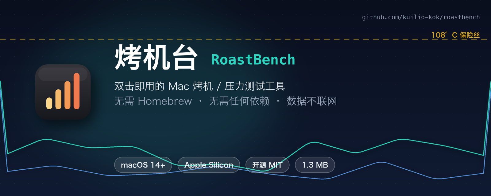
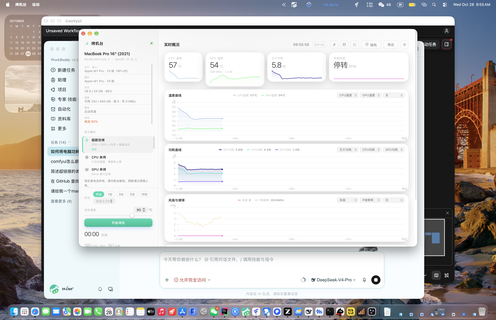

<div align="center">



[](https://github.com/kuilio-kok/roastbench/releases/latest)
[](https://github.com/kuilio-kok/roastbench/releases)
[](https://github.com/kuilio-kok/roastbench/stargazers)
[](LICENSE)
[](#%F0%9F%93%96-%E4%BD%BF%E7%94%A8%E6%96%B9%E6%B3%95)

**双击就能用的 Mac 烤机（压力测试）工具。**
不装 Homebrew，不敲一行命令，打开就烤。

[📥 下载最新版](https://github.com/kuilio-kok/roastbench/releases/latest) · [✨ 功能亮点](#-它能做什么) · [⚖️ 和别的方法比](#️-老方法-vs-烤机台) · [📖 使用方法](#-使用方法) · [❓ FAQ](#-faq)

</div>

---

## 🤔 为什么做它

买了新 Mac，总会想问几个问题：这机器满载到底多烫？风扇会不会起飞？标称的功耗墙能顶多久？

要回答这些问题，通常得开终端跑 `yes > /dev/null`，或者装一套 Homebrew + Python 监控工具。对很多人来说门槛太高了。**烤机台把这些全装进了一个 1.3 MB 的 App 里**——双击打开，点一个按钮，剩下的交给它。

> 「烤机」是硬件圈的叫法：让电脑长时间满载运行，测试散热、功耗和稳定性，就像把机器放进烤箱里烤一遍。

## ⚖️ 老方法 vs 烤机台

| | 终端命令党 | Xcode Instruments | 🔥 烤机台 |
|---|:---:|:---:|:---:|
| 上手门槛 | 要会命令行 | 要装几个 GB 的 Xcode | **双击打开** |
| 实时曲线 | ❌ 纯靠手摸 | ✅ 但界面复杂 | ✅ 60 fps，专为烤机设计 |
| 自动找温度墙 | ❌ | ❌ | ✅ 温度探底模式 |
| S / A / B / C 成绩单 | ❌ | ❌ | ✅ 一键拷贝发朋友圈 |
| 温度保险丝 | ❌ 裸奔 | ❌ | ✅ 108 °C 自动停 |
| 体积 | — | GB 级 | **1.3 MB** |

<a id="-它能做什么"></a>

## ✨ 它能做什么

- **自动认识你的 Mac** — 打开就知道你的机型、芯片、P/E 核数量、内存、有没有风扇、插没插电，并据此推荐合适的烤机模式
- **六种烤法**，想怎么烤就怎么烤（见下表）
- **实时曲线图** — 温度、功耗、风扇转速、P 核频率 60 fps 平滑滚动，压力测试第一次可以「看得见」
- **温度保险丝** — 默认 108 °C 自动断电保护（可关）。烤机是测极限，不是烧机器
- **成绩单** — 烤完给你一个 S / A / B / C 评级和徽章，一键拷贝，可以直接发朋友圈晒机
- **拔电秒感知** — 烤到一半拔掉电源？立刻弹提示，功耗墙状态即时更新
- **菜单栏常驻** — 收进菜单栏也能看温度、控制烤机

### 🍱 六种烤法

| 模式 | 适合场景 |
|---|---|
| 🔥 极限双烤 | CPU + GPU + 内存一起满载，模拟最恶劣工况 |
| 🧠 CPU 单烤 | 满载 CPU，测处理器散热与降频表现 |
| 🎮 GPU 单烤 | 满载 GPU，测图形负载下的表现 |
| 🌡️ 温度探底 | 烤 45 秒、歇 15 秒，自动找出这台机器的**温度墙** |
| 🥶 凉拌模式 | 专为准无风扇机器（MacBook Air）设计的轻负载方案 |
| 🔋 电池降频 | 用电池烤，看拔电后功耗墙掉了多少 |

## 📸 界面一览



> 实时温度 / 功耗 / 风扇转速 / P 核频率三条曲线，60 fps 平滑滚动，烤到几度一目了然。

<a id="-使用方法"></a>

## 📖 使用方法

1. 到 [Releases](https://github.com/kuilio-kok/roastbench/releases/latest) 下载 `烤机台 v2.7.zip`，解压
2. 把 `烤机台.app` 拖进「应用程序」文件夹（可选）
3. 第一次打开，macOS 会提示「无法验证开发者」——**右键点击 烤机台.app → 打开 → 打开**，只需要做一次

   或者终端执行：`xattr -dr com.apple.quarantine 烤机台.app`
4. 选一个模式，点「开始烤机」⏱

### 系统要求

- macOS 14 (Sonoma) 或更高
- 实时图表功能需要 **Apple Silicon（M 系列）**；Intel Mac 仍可以烤 CPU / GPU，但图表没有数据
- 烤机时机身会发烫、风扇会转——这是正常的。摸着烫手就让机器歇会儿 ☕

<a id="-faq"></a>

## ❓ FAQ

<details>
<summary><b>会不会把我的 Mac 烤坏？</b></summary>
<br>

不会。macOS 自带完善的过热保护，芯片到临界温度会强制降频，物理层面烧不坏。烤机台在此之上还加了一道 108 °C 温度保险丝，到点自动收工（可以关）。烤机是测极限，不是烧机器。

</details>

<details>
<summary><b>为什么打开时提示「无法验证开发者」？</b></summary>
<br>

本 App 没有做公证（公证需要付费的 Apple 开发者账号），macOS 对未公证 App 的默认处理就是拦一下。**右键点击 → 打开 → 打开**即可放行，只需要第一次这样做。

</details>

<details>
<summary><b>Intel Mac 能用吗？</b></summary>
<br>

能。App 本身是 arm64 + x86_64 双架构通用二进制，Intel 机器可以正常烤 CPU / GPU；但实时图表依赖 Apple Silicon 的传感器接口（macmon），所以 Intel 上图表没有数据。

</details>

<details>
<summary><b>我的数据会上传吗？</b></summary>
<br>

不会。所有传感器数据只在本机流转，App **完全不联网**，没有任何统计、上报或遥测。不放心的可以自己抓包验证。

</details>

<details>
<summary><b>烤机时风扇狂转、机身发烫正常吗？</b></summary>
<br>

正常，这正是烤机的意义——让机器在最恶劣工况下暴露散热短板。建议把电脑放在硬质平面上，摸着烫手就让机器歇会儿 ☕

</details>

<a id="-从源码构建"></a>

## 🛠 从源码构建

```bash
git clone https://github.com/kuilio-kok/roastbench.git
cd roastbench
./build.sh
```

构建脚本会编译 arm64 + x86_64 双架构通用二进制、生成图标，并输出 `烤机台.app`。需要 Xcode 命令行工具（`xcode-select --install`）。

## 🧩 技术实现

- **原生外壳，Web 内芯**：Swift + WKWebView，界面用 HTML / CSS / JS 画，通过自定义 URL Scheme 与原生层通信，无需任何框架依赖
- **数据源**：内嵌 [macmon](https://github.com/vladkens/macmon)（Apple Silicon 专属），免密码读取传感器数据，省掉了 Homebrew
- **隐私**：所有数据只在本机流转，**App 完全不联网**，没有任何统计、上报或遥测

## 🌍 English

**RoastBench** is a double-click stress-test ("burn-in") utility for Mac — no Homebrew, no terminal, no dependencies. It offers six burn modes (full load / CPU / GPU / thermal-wall finder / fanless-friendly / battery), 60 fps real-time temperature · power · fan · frequency charts, an automatic 108 °C thermal fuse, and a shareable S/A/B/C score card. All data stays on your machine — the app never touches the network.

Requires macOS 14+; live charts need Apple Silicon. [中文说明见上文](#-为什么做它) · [Download →](https://github.com/kuilio-kok/roastbench/releases/latest)

## ⚠️ 已知限制

- 没有做公证（没有 Apple 开发者账号），所以第一次打开需要右键 → 打开
- Intel Mac 不支持实时图表
- 温度探底等长时间满载模式会让机身很烫，请把电脑放在硬质平面上使用

## 📄 许可证

[MIT](LICENSE) · 感谢 [macmon](https://github.com/vladkens/macmon) 提供传感器数据支持

---

<div align="center">

如果烤机台帮你看清了你的 Mac，欢迎点个 ⭐ 支持一下<br>
这是作者的第一个开源产品，你的 star 是继续迭代的最大动力 ⚡

</div>
